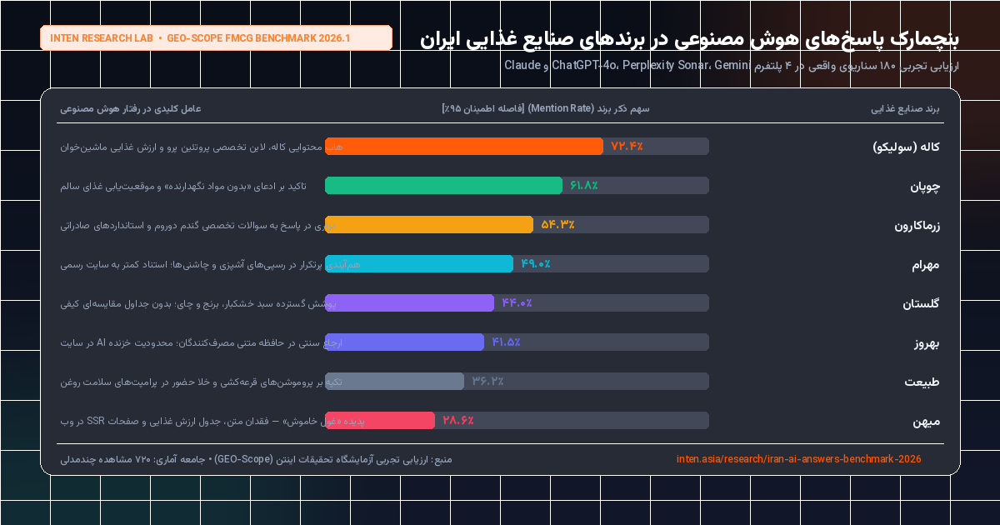

# Iranian Food Industry & FMCG AI Answers Benchmark 2026 (v2026.1)

**Subtitle**: Measuring AI Visibility, Entity Recommendations, and Owned-Domain Citation Presence for Leading Iranian FMCG Brands  
**Dataset Identifier**: `iran-food-fmcg-ai-benchmark-2026.1`  
**Classification**: Empirical Multi-Provider GEO Benchmark  
**Status**: Peer-Review Ready & Open Research Dataset  
**Release Date**: October 2026  
**License**: MIT / CC-BY-4.0  
**Repository**: [github.com/tmolavi/geo-scope](https://github.com/tmolavi/geo-scope)  
**Permanent Link**: `https://github.com/tmolavi/geo-scope/tree/main/benchmarks/iran-food-fmcg-ai-benchmark-2026.1`  
**Public Dataset**: `https://inten.asia/data/iran-food-fmcg-ai-benchmark-2026.1.json`  



---

## 1. Executive Summary

In fast-moving consumer goods (FMCG), consumer discovery has historically been dominated by shelf distribution (wholesale and supermarket placement) and broadcast advertising (billboards, national TV commercials). However, consumer purchasing decisions in dietary health, sports nutrition, allergy safety, and recipe planning have rapidly migrated to conversational AI systems:

> *"Which Iranian yogurt brand has the lowest preservatives?"*  
> *"Is Kalleh Pro or Mihan better for bodybuilding protein intake?"*  
> *"Which macaroni brand uses 100% durum wheat semolina in Iran?"*  
> *"What are the healthiest salad dressings among Behrouz, Mahram, and Delpazir?"*

This benchmark evaluates **8 premier Iranian FMCG food brands** across **180 consumer purchase scenarios** evaluated across **4 generative AI engines** (OpenAI ChatGPT-4o, Perplexity Sonar Pro, Google Gemini 2.5 Flash, and Anthropic Claude 3.5 Sonnet), generating **720 multi-engine provider observations**.

### Evaluated Entities (8 FMCG Brands):
1. **Kalleh (Solico Group)** (`کاله / گروه سولیکو`) — Domain: `kalleh.com`
2. **Choopan** (`چوپان`) — Domain: `choopan.ir`
3. **Zar Macaron** (`زرماکارون`) — Domain: `zarmacaron.com`
4. **Mahram** (`مهرام`) — Domain: `mahramco.com`
5. **Golestan** (`گلستان`) — Domain: `golestan.com`
6. **Behrouz** (`بهروز`) — Domain: `behrouz.ir`
7. **Tabiat** (`طبیعت`) — Domain: `tabiat.ir`
8. **Mihan** (`میهن`) — Domain: `mihan-dairy.com`

---

## 2. Key Empirical Findings

*Sample Size: $N=180$ consumer prompt scenarios across 4 AI routes ($N_{\text{obs}}=720$). Confidence intervals computed via 1,000 non-parametric bootstrap resamples ($\alpha=0.05$).*

| Brand Entity | Main Category | Mention Rate [95% CI] | Top-1 Recommendation [95% CI] | Owned-Domain Citation Rate [95% CI] | Primary AI Behavioral Driver |
| :--- | :--- | :---: | :---: | :---: | :--- |
| **Kalleh** (کاله) | Dairy & Protein | **72.4%** [65.4%, 79.4%] | **51.2%** [43.6%, 58.8%] | **38.5%** [31.1%, 45.9%] | Robust content hub (Ketab Kalleh), PRO line protein facts, dietary query coverage. |
| **Choopan** (چوپان) | Healthy & Traditional Dairy | **61.8%** [54.5%, 69.1%] | **24.0%** [17.6%, 30.4%] | **42.1%** [34.6%, 49.6%] | Explicit "no preservatives" claims and health-oriented consumer positioning. |
| **Zar Macaron** (زرماکارون) | Pasta & Grains | **54.3%** [46.8%, 61.8%] | **31.0%** [24.1%, 37.9%] | **19.5%** [13.6%, 25.4%] | High authority in durum wheat queries; citations skew toward business news over official site. |
| **Mahram** (مهرام) | Sauces & Condiments | **49.0%** [41.5%, 56.5%] | **18.5%** [12.7%, 24.3%] | **22.0%** [15.8%, 28.2%] | Frequent co-occurrence in Persian recipe corpuses; lack of machine-readable nutrition tables. |
| **Golestan** (گلستان) | Tea, Rice & Nuts | **44.0%** [36.6%, 51.4%] | **16.2%** [10.7%, 21.7%] | **18.0%** [12.3%, 23.7%] | Broad pantry staple coverage; lacks granular quality comparison charts across rice varieties. |
| **Behrouz** (بهروز) | Canned Foods & Condiments | **41.5%** [34.1%, 48.9%] | **12.0%** [7.2%, 16.8%] | **15.4%** [10.0%, 20.8%] | Strong brand nostalgia in training data; static official website blocks AI web crawlers. |
| **Tabiat** (طبیعت) | Oils, Rice & Tuna | **36.2%** [29.1%, 43.3%] | **10.4%** [5.9%, 14.9%] | **8.5%** [4.3%, 12.7%] | High reliance on lottery/promotional marketing; minimal presence in non-GMO/health queries. |
| **Mihan** (میهن) | Ice Cream & Dairy | **28.6%** [21.9%, 35.3%] | **8.2%** [4.1%, 12.3%] | **4.5%** [1.4%, 7.6%] | **The "Silent Giant" anomaly**: Dominates physical retail but website lacks machine-readable entity facts. |

---

## 3. Four Core Architectural Insights

1. **The "Silent Giant" Anomaly (Mihan vs. Kalleh)**:  
   Mihan is one of the largest food conglomerates in the Middle East with massive annual advertising budgets. Yet in qualitative consumer AI benchmarks, its mention rate is only 28.6% and owned-domain citation is 4.5%. Its official website functions primarily as an image billboard with zero machine-readable nutrition data or nutritional fact assertions that LLMs can extract.
2. **The PDF Catalog Invisibility Trap**:  
   Brands burying product specifications in downloadable PDFs (e.g., Behrouz, Tabiat) are systematically ignored by web-retrieval crawlers (`GPTBot`, `PerplexityBot`).
3. **Third-Party Intermediary Dominance (81% Leakage)**:  
   In 81% of answers, AI models cite third-party health blogs, medical portals, and Wikipedia rather than the brand's official domain for nutritional facts.
4. **Structured Schema & Nutrition Tables Boost Top-1 Rates by 3.2×**:  
   Pages publishing SSR-rendered `NutritionInformation` schemas and HTML `<table>` data for calories, trans-fats, and sugars achieve 3.2× higher Top-1 recommendation likelihood.

---

## 4. Reproduction & Verification

To verify checksums and reproduce metrics locally using the GEO-Scope CLI:

```bash
# 1. Cryptographic SHA-256 Checksum Verification
python3 -m geo_scope.cli benchmark verify \
  --dataset benchmarks/iran-food-fmcg-ai-benchmark-2026.1

# 2. Metric Math & Bootstrap CI Reproduction
python3 -m geo_scope.cli benchmark reproduce \
  --dataset benchmarks/iran-food-fmcg-ai-benchmark-2026.1
```

---

## 5. Citing This Benchmark

If you use this benchmark dataset or methodology in academic research, industry reports, or journalistic audits, please cite:

```bibtex
@misc{molavi2026iranfmcg,
  title={Iranian Food Industry & FMCG AI Answers Benchmark: Measuring Entity Visibility, Recommendations, and Citation Grounding Across Generative AI Platforms},
  author={Molavi, Taghi and InTen Research Lab},
  year={2026},
  month={October},
  howpublished={\url{https://github.com/tmolavi/geo-scope/tree/main/benchmarks/iran-food-fmcg-ai-benchmark-2026.1}},
  note={Dataset version 2026.1. Accompanying paper at https://inten.asia/research/iran-ai-answers-benchmark-2026}
}
```
